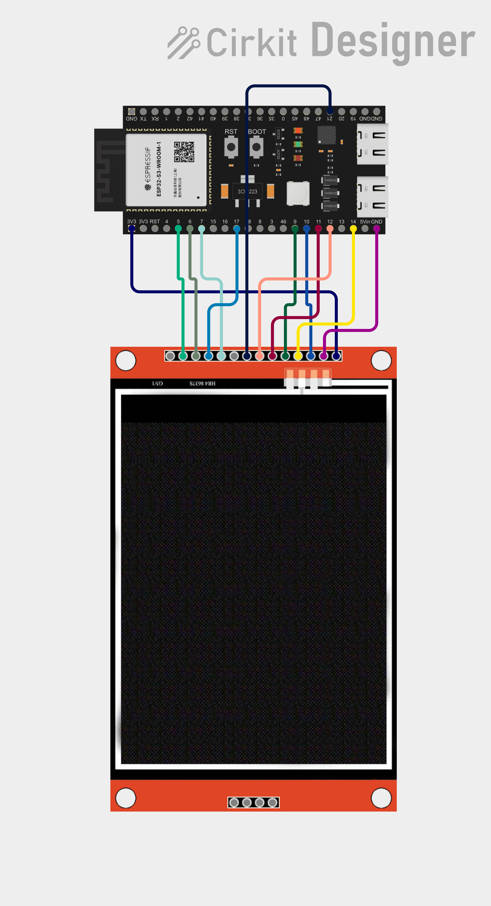
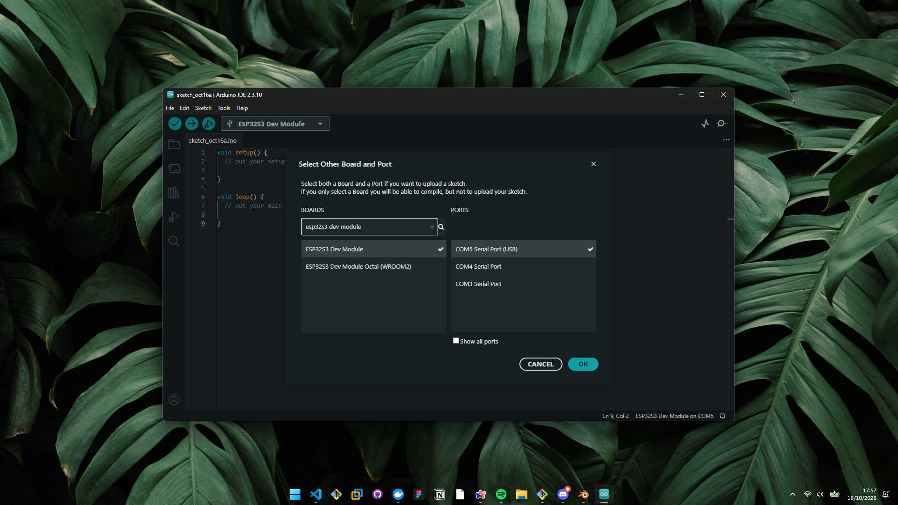
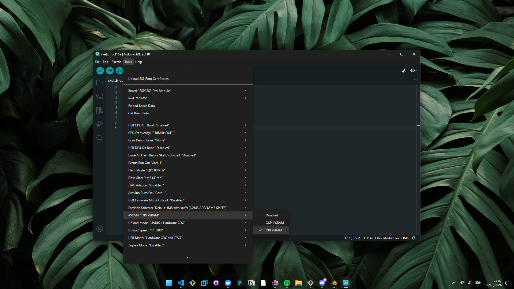

# Pomodoro tactile ESP32-S3

Un minuteur pomodoro fait maison avec un ESP32-S3 et un écran tactile SPI de 3,5 pouces. Dark mode, animations pendant les sessions (nuages qui défilent au boulot, chat qui dort en pause), et tout est gratuit et open source. Fais-en ce que tu veux.

## Ce qu'il te faut

- Un **ESP32-S3** (testé avec un modèle N16R8, 16 Mo de flash + 8 Mo de PSRAM, Wi-Fi + Bluetooth)
- Un **écran tactile SPI 3,5"** (contrôleur ILI9488 + dalle tactile résistive XPT2046)
- Un **câble USB-C** pour programmer et alimenter la carte
- Quelques fils Dupont pour le branchement (12 précisément)

> Liens pour acheter les composants : *à compléter avec tes propres liens*

## Comment c'est organisé

Le code est en C++ (Arduino), éclaté en plusieurs fichiers pour que ce soit lisible :

- `pomodoro/pomodoro.ino` : le point d'entrée, `setup()` et `loop()`
- `pomodoro/config.h` : broches, couleurs, constantes de réglage
- `pomodoro/touch.ino` : lecture du tactile, calibrage
- `pomodoro/display.ino` : tout ce qui s'affiche à l'écran
- `pomodoro/timer.ino` : la logique du minuteur (phases travail/pause)
- `pomodoro/storage.ino` : sauvegarde des réglages en mémoire
- `outils/genere_animations.py` : script qui génère les images animées (chat qui dort, nuages) (script généré par IA)

## Étape 1 : récupère le projet

```
git clone <lien-de-ce-repo>
```

## Étape 2 : installe Arduino IDE et le support ESP32

1. Télécharge et installe [Arduino IDE](https://www.arduino.cc/en/software) (version 2.x).
2. Va dans **File > Preferences**, et colle cette URL dans *Additional boards manager URLs* :
   ```
   https://raw.githubusercontent.com/espressif/arduino-esp32/gh-pages/package_esp32_index.json
   ```
3. Ouvre **Tools > Board > Boards Manager**, cherche `esp32`, installe le package **esp32 by Espressif Systems**.

## Étape 3 : installe les bibliothèques nécessaires

Dans **Sketch > Include Library > Manage Libraries**, installe :

- `XPT2046_Touchscreen` (Paul Stoffregen)
- `GFX Library for Arduino` (moononournation). C'est elle qui fournit `Arduino_GFX_Library.h`
- `AnimatedGIF` (bitbank2)

## Étape 4 : branche l'écran



Le détail des broches utilisées est dans `pomodoro/config.h`. Voici la correspondance avec les pins sérigraphiées sur le module (utile pour suivre le câblage sans se prendre la tête) :

| Pin du module | GPIO ESP32-S3 |
|---|---|
| VCC | 3V3 |
| GND | GND |
| CS | 10 |
| RESET | 14 |
| DC/RS | 9 |
| SDI | 11 |
| SCK | 12 |
| LED | 21 |
| T_CLK | 7 |
| T_CS | 17 |
| T_OUT | 5 |
| T_DIN | 6 |

## Étape 5 : ouvre le sketch et choisis ta carte

Ouvre `pomodoro/pomodoro.ino` dans Arduino IDE, puis sélectionne ta carte et ton port :



Choisis **ESP32S3 Dev Module** et le port COM sur lequel ta carte est branchée.

## Étape 6 : règle les options de la carte

Dans **Tools**, voici les réglages qui marchent chez moi :



Les plus importants :
- **USB CDC On Boot** : Enabled
- **PSRAM** : OPI PSRAM
- **Upload Mode** : UART0 / Hardware CDC

Si ta puce a plus de flash (16 Mo comme la mienne), tu peux augmenter *Flash Size* et choisir un *Partition Scheme* plus généreux pour avoir plus de place. Avec les réglages par défaut ça tourne très bien aussi, le projet tient largement dans 4 Mo.

## Étape 7 : téléverse

Clique sur la flèche "Téléverser" (ou `Ctrl+U`). Si tu as une erreur du style *"This chip is ESP32-S3, not ESP32"*, c'est juste que la mauvaise carte est sélectionnée dans **Tools > Board**, retourne à l'étape 5.

## Étape 8 : premier démarrage

Au tout premier démarrage, l'écran te demande de toucher 3 croix pour calibrer le tactile. Vise bien les croix sois pas con. Tu peux relancer ce calibrage à tout moment en maintenant le bouton **BOOT** de la carte pendant 1 seconde (si jamais t'as réussis par je ne sais quel moyen à te rater).

## C'est fait, amuse-toi bien

Le code est 100% gratuit, fais-en ce que tu veux : le modifier, le forker, l'améliorer. Si tu butes sur un truc, ouvre une issue sur le repo (ou pas parce que je vais surement jamais revenir ici mais sait-on jamais).
